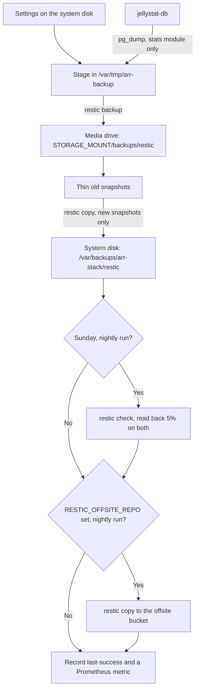
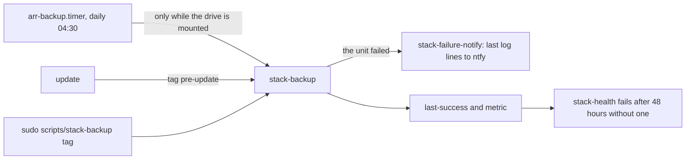
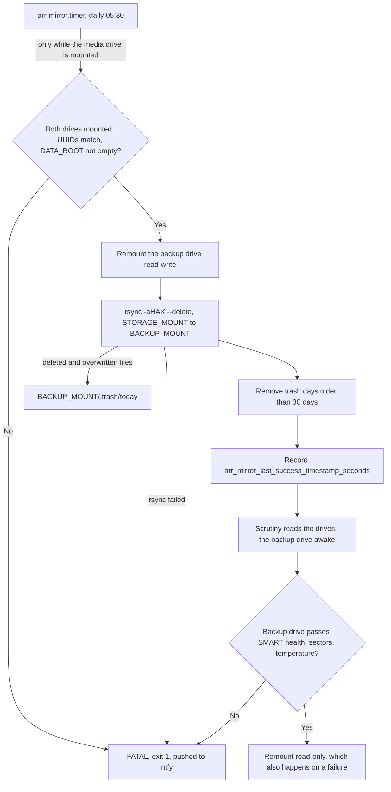

# Backups

This page explains how the stack backs up its settings every night, where the copies go, and how
to restore from them after anything from one broken setting to a dead disk. It also covers the
optional mirror of the whole media drive onto a second drive. It is for whoever looks after the
server.

Every night the stack's **settings** (never media) are backed up with [restic](https://restic.net)
to the media drive, then copied to the system disk. Each disk holds a full, encrypted, independent
copy, so either one can die without losing the history. An offsite copy is optional. With a
second drive, a nightly [media mirror](#the-media-mirror) also copies the whole media drive,
media included.



## What is backed up

`scripts/stack-backup` runs as root (the app folders belong to several container users) and stages
these into `/var/tmp/arr-backup`, a private folder deleted after every run:

| What | From | Why |
|---|---|---|
| Every app's settings and databases | `$CONFIG_ROOT/<app>/` | The whole configured state of the stack |
| Update and rollback records, metrics, watcher state | `$STATE_ROOT` (the `state` folder next to `CONFIG_ROOT`) | Rollbacks and alerts keep working after a restore |
| Every secret: VPN key, API keys, logins | `.env` | Nothing works without it |
| Terminal tool configs | `~/.config/managarr`, `~/.config/qbt-tui` of `STACK_USER` | Hand-made |
| Hand-edited host files, when present | `/etc/fstab`, `/boot/firmware/cmdline.txt`, `/etc/docker/daemon.json`, `/etc/avahi/avahi-daemon.conf`, `~/.ssh/authorized_keys` | A reinstall would lose them ([host changes](../operations/host.md)) |
| Jellystat's watch history | `pg_dump -Fc` of the `jfstat` database in `jellystat-db` | Only while the `stats` module is on |

The optional VPN failover pool in `$CONFIG_ROOT/gluetun/verified-servers` is included. Restore
both JSON files together with `.env` and the repository's failover preset, seed, and startup wrapper before
recreating gluetun. See [VPN pool restore](vpn-and-ports.md#refresh-restore-and-upgrade).

## What never is

- **Media and downloads.** They can be downloaded again. The optional
  [media mirror](#the-media-mirror) copies them to a second drive instead.
- **What the apps rebuild themselves:** folders named `logs`, `cache`, `transcodes`, `Backups`
  (the apps' own backup folders), `Crash Reports`, `Codecs`, `Media`, `Metadata`, `MediaCover` and
  `venv`; `*.log` files and `logs.db`; sockets and FIFOs (qBittorrent's `ipc-socket`, for example).
- **These paths:** Grafana's plugins, Recyclarr's copy of the TRaSH guides, Scrutiny's SMART
  history database, gluetun's default `servers` cache, Jellyfin's extracted subtitles, and Jellystat's raw
  Postgres files (the dump covers them).
- **What the repository reinstalls:** systemd units, the firewall and SSH hardening
  (`scripts/host-install`), the Docker images, and Tailscale's login.
- **The rest of the home folder.**

## Why the databases are copied carefully

Several apps (Radarr, Prowlarr, Jellyfin, Bazarr, Cleanuparr) run SQLite in WAL mode: their newest
writes sit in a separate `-wal` file, not in the `.db` file. Copying the `.db` alone silently loses
them. Cleanuparr is the extreme case: its `cleanuparr.db` can be 4 KB while its settings sit in a
2.4 MB WAL, so a plain copy would restore a blank Cleanuparr and look completely normal doing it.

So every `.db`, `.sqlite` and `.sqlite3` file is copied through SQLite's online backup API, which
reads through SQLite and produces a complete, consistent copy with no app stopped. The live
`-wal`, `-shm` and `-journal` files are left out because the copy already contains them. An app in
the middle of a checkpoint can hold its database for a moment, so each copy is retried up to five
times, three seconds apart, before the run fails. A file with a database suffix that is not SQLite
is copied as a plain file.

## The run, step by step

1. **Skip if the drive is off.** Without the media mount, the script prints a note and exits
   successfully. The drive is powered by hand, so this is not a failure.
2. **Key file.** The restic password from `RESTIC_PASSWORD` in `.env` is also written to
   `$STORAGE_MOUNT/backups/RESTIC_PASSWORD` (mode 600), next to the repository. If the password
   lived only in `.env` on the system disk, a dead system disk would leave these backups unreadable.
3. **First run.** If `$STORAGE_MOUNT/backups/restic` has no repository yet, it is created.
4. **Stage** everything listed above into `/var/tmp/arr-backup`, with the SQLite copies and the
   Jellystat dump.
5. **Back up** the staging folder: `restic backup --tag arr-stack` (plus any extra tag, such as
   `pre-update`), with `HOST_NAME` as the snapshot host. restic encrypts, deduplicates and
   compresses. The staging folder is then deleted, even if the backup failed.
6. **Thin** the media drive's repository (see [Retention](#retention)).
7. **Copy to the system disk.** `restic copy` sends only new snapshots to
   `/var/backups/arr-stack/restic` (root only), then thins it the same way. The first time, that
   repository is created with the same chunker parameters as the one on the drive, so copies
   deduplicate.
8. **Weekly check.** On a Sunday's nightly run, `restic check --read-data-subset=5%` reads back 5%
   of the stored data in both repositories, to catch a disk silently corrupting it.
9. **Offsite copy**, on nightly runs only, when `RESTIC_OFFSITE_REPO` is set (see [Offsite](#offsite)).
10. **Record success** in `/var/lib/arr-backup/last-success` and as the metric
    `arr_backup_last_success_timestamp_seconds` in `$STATE_ROOT/metrics/backup.prom` (written
    whole and renamed into place). The last lines printed are the number of databases and the
    snapshot id, which `stack-update` reads.

A "nightly run" means one without an extra tag. A `pre-update` snapshot from `stack-update` is copied to
the system disk but skips the weekly check and the offsite copy.

## When it runs



| When | How |
|---|---|
| Daily at 04:30 | [`arr-backup.timer`](../reference/systemd.md#arr-backuptimer), up to 15 minutes of random delay. `Persistent=true`: if the server or drive was off at 04:30, it runs at the next chance. The service runs at low CPU and idle I/O priority and is skipped, not failed, while the drive is unmounted. |
| Before every `stack-update` | The same run, tagged `pre-update`. `stack-update` stops if it fails, and `stack-update --rollback` restores from it ([Updates](updates.md)). |
| By hand | `sudo scripts/stack-backup` (about a minute). Add a tag to mark it: `sudo scripts/stack-backup pre-change`. It prints `snapshot <id>` at the end. |

A failed nightly run pushes its last log lines to ntfy through `arr-notify-failure@`.
`stack-health` fails once the last good backup is more than 48 hours old (checked only while the
drive is mounted), and also checks that the key file is on the drive and the system disk copy
exists. Prometheus keeps the last-success metric, so Glance and Grafana show its age.

## Retention

The same rules apply to the media drive, the system disk and the offsite copy:

| Kept | Snapshots |
|---|---|
| Daily | 7 |
| Weekly | 4 |
| Monthly | 6 |
| `pre-update` | The last 5, outside the thinning above |

The `pre-update` snapshots are exempt from the daily thinning, which would otherwise drop one taken
earlier the same day as the nightly run. On the reference install a snapshot restores to about
830 MB (roughly 1,800 files) and all snapshots together take about 700 MB per disk.

## The password

Encrypted backups need their password. It lives in `.env` **and** in
`$STORAGE_MOUNT/backups/RESTIC_PASSWORD`. The second copy is the one that matters: if the system
disk dies, `.env` dies with it. Save it in your password manager as well. The copy on the drive
protects against a disk failing, which is the goal, not against someone who takes the drive.

Pass the password to restic with `--password-file` or an environment variable, never on the
command line, where `ps` would show it.

## What survives what

| What fails | Live settings | Media drive backups | System disk copy | Backup drive mirror | Restore from |
|---|---|---|---|---|---|
| The system disk | lost | kept | lost | kept | [the media drive, with its key file](#a-dead-system-disk) |
| The media drive | kept | lost | kept | kept, media too | settings: [nothing to restore](#a-dead-media-drive); media: [the backup drive](#swapping-the-backup-drive-in) |
| A setting you broke | kept | kept | kept | kept | [any snapshot from either disk](#one-apps-settings) |
| A media file deleted or replaced | not applicable | not applicable | not applicable | in its trash for 30 days | [the backup drive's trash](#restoring-files-from-the-mirror) |
| Theft, fire, a power surge | lost | lost | lost | lost | only an [offsite copy](#offsite) |

The mirror column applies only with a backup drive (`BACKUP_UUID` set).

## Restoring

Restores change live data: stop the app first, and if an AI agent is doing it, it must ask you
first ([AI agent](ai-agent.md)).

### Where things are inside a snapshot

Everything sits under the staging path it was backed up from:

| Inside the snapshot | Came from |
|---|---|
| `/var/tmp/arr-backup/config/<app>/` | `$CONFIG_ROOT/<app>/` |
| `/var/tmp/arr-backup/home/.env` | `.env` |
| `/var/tmp/arr-backup/home/state/` | `$STATE_ROOT` |
| `/var/tmp/arr-backup/home/managarr/`, `home/qbt-tui/` | `~/.config/managarr`, `~/.config/qbt-tui` |
| `/var/tmp/arr-backup/host/...` | The host files, under their full path (`host/etc/fstab`, `host/home/<user>/.ssh/authorized_keys`) |
| `/var/tmp/arr-backup/jellystat.dump` | Jellystat's database |

Staged files are written by root, so restored files belong to root until you give them back.

### Listing snapshots

```bash
REPO=/mnt/storage/backups/restic   # $STORAGE_MOUNT/backups/restic
sudo restic -r "$REPO" --password-file /mnt/storage/backups/RESTIC_PASSWORD snapshots --compact
```

To read the password from `.env` instead (the system disk copy, for example):

```bash
export RESTIC_PASSWORD=$(sed -nE "s/^RESTIC_PASSWORD=(['\"]?)(.*)\1$/\2/p" .env)
sudo -E restic -r /var/backups/arr-stack/restic snapshots
```

The `sed` strips the quotes around a quoted value; a plain `cut -d= -f2-` would keep them, and
restic would reject the password.

### One app's settings

If an `stack-update` broke it, use `scripts/stack-update --rollback <service>`: it restores exactly that app's
folders from the snapshot taken just before the update ([Updates](updates.md#step-3-rolling-back)).
Otherwise:

1. Restore the app's folder from a snapshot into a temporary folder:

   ```bash
   sudo restic -r /mnt/storage/backups/restic --password-file /mnt/storage/backups/RESTIC_PASSWORD \
     restore <snapshot-id> --include /var/tmp/arr-backup/config/<app> --target /tmp/restore
   ```

2. Compare it with the live folder, and decide what to bring back.
3. Stop the app: `docker compose stop <app>`.
4. Delete the `-wal` and `-shm` files next to every database you are about to replace. The
   restored databases are complete copies; stale WAL files beside them would be replayed on top
   and corrupt them.
5. Copy the restored files over the live folder (`sudo cp -a`), rather than replacing the folder:
   caches and artwork were never backed up.
6. Give the folder back to its owner:
   `sudo chown -R "$(stat -c %u:%g "$CONFIG_ROOT/<app>")" "$CONFIG_ROOT/<app>"`.
7. Start the app (`docker compose up -d <app>`) and run `scripts/stack-health`.

### A dead system disk

`.env` and the system disk copy are gone; the media drive holds every snapshot and the key file.

1. Reinstall the operating system and Docker, and clone the repository, as in
   [Getting started](../getting-started.md). Mount the media drive.
2. Restore the latest snapshot with the key file on the drive:

   ```bash
   sudo restic -r /mnt/storage/backups/restic \
     --password-file /mnt/storage/backups/RESTIC_PASSWORD restore latest --target /tmp/r
   ```

3. Put `.env` back from `/tmp/r/var/tmp/arr-backup/home/.env` instead of writing a new one.
4. Compare the host files under `/tmp/r/var/tmp/arr-backup/host/` with the new system and carry
   over your changes by hand. Don't copy `/etc/fstab` or `cmdline.txt` wholesale: they name the
   old disk's partitions. `authorized_keys` can go back as it is.
5. Run `scripts/host-install` and let the stack start once, so every app creates its folders with
   the right owners. Then stop it: `docker compose stop`.
6. For each app, restore its folder as in [One app's settings](#one-apps-settings), steps 4 to 6,
   from `/tmp/r/var/tmp/arr-backup/config/<app>/`. Copy `home/state/` back to `$STATE_ROOT` and
   the terminal tool configs to `~/.config/`.
7. Start the stack, [restore Jellystat's history](#jellystats-history) if you use it, and run
   `scripts/stack-health`. The next nightly run recreates the system disk copy.

### A dead media drive

Your live settings are untouched, and the system disk copy holds the same snapshots:

```bash
export RESTIC_PASSWORD=$(sed -nE "s/^RESTIC_PASSWORD=(['\"]?)(.*)\1$/\2/p" .env)
sudo -E restic -r /var/backups/arr-stack/restic snapshots
```

Once a new drive is mounted ([Storage and boot](storage-and-boot.md)), the next nightly run
creates a fresh repository and key file on it. The system disk copy keeps the older snapshots and
receives the new ones. With a backup drive, the media survived too:
[swap it in](#swapping-the-backup-drive-in) instead of starting from an empty drive.

### Jellystat's history

The dump is in Postgres's custom format. Restore it with `pg_restore` while Jellystat itself is
stopped:

```bash
docker compose stop jellystat
docker exec -i jellystat-db sh -c 'pg_restore -U "$POSTGRES_USER" -d "$POSTGRES_DB" --clean --if-exists' \
  < /tmp/r/var/tmp/arr-backup/jellystat.dump
docker compose up -d jellystat
```

If you use Grafana's watching dashboard, run `python3 scripts/configure-grafana-watch.py`
afterwards; it verifies (and if needed recreates) its read-only reader
([Monitoring](monitoring.md#the-watching-dashboard)).

## Offsite

Set `RESTIC_OFFSITE_REPO` in `.env` to a Backblaze B2 or any S3-compatible bucket
(`b2:<bucket>:arr` or `s3:<endpoint>/<bucket>/arr`), with that backend's credentials beside it:
`B2_ACCOUNT_ID` and `B2_ACCOUNT_KEY`, or `AWS_ACCESS_KEY_ID` and `AWS_SECRET_ACCESS_KEY`. Variables
starting with `AWS_`, `B2_`, `AZURE_`, `GOOGLE_` or `RCLONE_` are passed to restic. Each nightly
run then copies its new snapshots there, encrypted with the same `RESTIC_PASSWORD` and thinned the
same way; the first run creates the repository. A failure shows in `journalctl -u arr-backup` and
is pushed to ntfy.

## The media mirror

With a second drive (set up in [Host setup](../operations/host.md#the-backup-drive), `BACKUP_UUID`
in `.env`), [`storage-mirror`](../reference/scripts.md#storage-mirror) copies the whole media drive
onto it every night: media, downloads, the restic repository and its key file. It runs at 05:30,
after the 04:30 settings backup, so the copy carries that night's snapshot too.



- **An exact copy.** `rsync -aHAX --numeric-ids --delete` from `$STORAGE_MOUNT/` to
  `$BACKUP_MOUNT/` keeps owners, permissions, ACLs, extended attributes and hardlinks, so a torrent
  and its library copy share the space on the backup drive too. Left out are `lost+found/`, the
  trash itself, and `$DATA_ROOT/usenet/incomplete/` and `$DATA_ROOT/soulseek/incomplete/`:
  unfinished downloads change all night and are fetched again anyway.
- **A 30-day trash.** A file deleted or overwritten on the media drive is not simply dropped from
  the copy: rsync moves it to `$BACKUP_MOUNT/.trash/<YYYY-MM-DD>/` under its original path, a
  rename on the same drive. The date is the night the mirror noticed, so a file deleted during the
  day is in the next night's folder. Trash days older than 30 days are removed after each
  successful run. The trash is pruned by age only; if it ever fills the drive, rsync fails and
  the failure reaches ntfy.
- **Read-only between runs.** The fstab line mounts the backup drive `ro`. The script remounts it
  read-write for the copy and back to read-only when it exits, whether the copy worked or not, so
  no container and no stray command can change it. `stack-health` fails when it finds the drive
  writable while no mirror runs.
- **Guards.** The run stops with `FATAL` unless `BACKUP_UUID` is set, both mounts are mount points,
  the backup mount holds the drive `BACKUP_UUID` names (and the media mount the one `STORAGE_UUID`
  names, when set), and `DATA_ROOT` is not empty. Mirroring from a missing or wrong media drive
  would delete the copy; mirroring onto an empty mount point would fill the system disk.
- **Vanished files are fine.** rsync's exit 24 (files vanished during the copy, normal while
  downloads run) counts as success.
- **The first copy takes hours:** about 3.3 TB took 5 to 6 hours over one USB 3 dock. Later runs
  copy only what changed.
- **Asleep between runs.** With [`arr-spindown.service`](../reference/systemd.md#arr-spindownservice)
  enabled, the backup drive spins down after 10 idle minutes, so it doesn't heat a shared dock
  around the clock. The mirror's first read wakes it, in about 10 seconds. `stack-health`,
  `drive-metrics` and Scrutiny's hourly run leave it asleep.
- **A health read after each copy.** While the drive is awake, the run has Scrutiny read the
  drives (`docker exec scrutiny scrutiny-collector-metrics run`), so Scrutiny's history of the
  backup drive gets a point every night, then runs the backup drive's SMART health, sectors and
  temperature checks. A failed check fails the run with `FATAL: the backup drive failed its SMART
  <check> check`, which reaches ntfy; the copy and its success metric are already done.

| When | How |
|---|---|
| Daily at 05:30 | [`arr-mirror.timer`](../reference/systemd.md#arr-mirrortimer), up to 10 minutes of random delay, `Persistent=true`. Lowest CPU and idle I/O priority. Skipped, not failed, while the media drive is off; a missing backup drive fails the run. |
| By hand | `sudo systemctl start --no-block arr-mirror.service`, followed with `journalctl -fu arr-mirror`. `sudo scripts/storage-mirror --dry-run` lists what the next run would change and touches nothing. |

A successful run writes `arr_mirror_last_success_timestamp_seconds` to
`$STATE_ROOT/metrics/mirror.prom`. Glance's Lab page shows "Media mirrored N ago", in red after 48
hours. `stack-health` checks that the backup drive is mounted, read-only, under 90% full and
healthy (SMART, sectors, temperature, passing unread while it is asleep), that `arr-mirror.timer` is enabled, and that the last mirror
is under 48 hours old (while the media drive is mounted). A failed run pushes its last log lines to
ntfy.

### Restoring files from the mirror

The backup drive is read-only, so read from it and copy back with `sudo`. `-a` keeps each file's
owner and permissions. Use your own `STORAGE_MOUNT`, `BACKUP_MOUNT` and `DATA_ROOT` if they
differ:

```bash
# A file or folder as it was at the last mirror
sudo cp -a /mnt/backup/data/media/movies/<film>/ /mnt/storage/data/media/movies/

# Something deleted or replaced: find the night, then copy it back
ls /mnt/backup/.trash/
sudo rsync -aH /mnt/backup/.trash/<date>/data/media/tv/<show>/ /mnt/storage/data/media/tv/<show>/
```

A restored file is a new copy: it no longer shares its space with a hardlink in `torrents/`.

### Swapping the backup drive in

The mirror is an exact copy of the media drive's root, so after the media drive dies the backup
drive can take its place as it is:

1. In `/etc/fstab`, put the backup drive's UUID on the `/mnt/storage` line, which has no `ro`, and
   delete the `/mnt/backup` line.
2. In `.env`, set `STORAGE_UUID` to that UUID and `STORAGE_DEVICE` to the drive's
   `/dev/disk/by-id/` path, and empty `BACKUP_UUID`: there is no backup drive until you add a new
   one.
3. Run `sudo systemctl disable arr-mirror.timer`, `sudo systemctl daemon-reload` and
   `scripts/host-install`, then mount it (`sudo mount /mnt/storage`, or switch it on); the stack
   starts with it.

What changed after the last mirror is lost: downloads since then come again, and the settings
live on the system disk anyway. The `.trash/` folder comes along; delete it once you don't need
it.

## Scripts and units involved

| Name | Role | Reference |
|---|---|---|
| `stack-backup` | Stages, backs up, copies, checks, records success | [scripts](../reference/scripts.md#stack-backup) |
| `arr-backup.timer` / `.service` | Daily at 04:30, only with the drive mounted | [systemd](../reference/systemd.md#arr-backuptimer) |
| `storage-mirror` | Mirrors the media drive onto the backup drive, keeps the trash, records success | [scripts](../reference/scripts.md#storage-mirror) |
| `arr-mirror.timer` / `.service` | Daily at 05:30, only with the media drive mounted | [systemd](../reference/systemd.md#arr-mirrortimer) |
| `storage-spindown` | Gives the backup drive its 10-minute idle timer | [scripts](../reference/scripts.md#storage-spindown) |
| `arr-spindown.service` | Runs it each time the backup drive mounts | [systemd](../reference/systemd.md#arr-spindownservice) |
| `99-arr-backup.rules` | Mounts the backup drive when it appears | [systemd](../reference/systemd.md#99-arr-backuprules) |
| `arr-notify-failure@.service` | Pushes a failed run's log lines to ntfy | [systemd](../reference/systemd.md#arr-notify-failureservice) |
| `stack-update` | Takes the `pre-update` snapshot, restores from it on rollback | [scripts](../reference/scripts.md#stack-update) |
| `stack-health` | Backup age, key file, system disk copy; the backup drive and the mirror's age | [scripts](../reference/scripts.md#stack-health) |
| `stack-backup` skill | Status, backup now, mirror now, restore (mirror and restore ask first) | [AI agent](ai-agent.md#the-skills) |

## When it goes wrong

- **`stack-health` fails "last backup under 48h old".** The nightly run was skipped, usually
  because the drive was off at 04:30; it catches up once the drive is back. Otherwise read
  `journalctl -u arr-backup`.
- **`stack-health` fails "media mirrored in the last 48h".** The mirror was skipped because the
  media drive was off at 05:30, or it failed: `journalctl -u arr-mirror` shows why, often a
  `FATAL` guard (the backup drive not mounted, or a UUID that doesn't match `.env`).
- **The mirror fails with "the backup drive failed its SMART ... check".** The copy finished and
  was recorded; the drive needs attention. Ask an AI agent with the `drive-health` skill, or read
  `sudo smartctl -a -d sat /dev/disk/by-id/<disk>`.
- **`stack-health` fails "backup drive read-only between mirrors".** Something remounted it
  read-write, or a run was killed before its exit trap: `sudo mount -o remount,ro /mnt/backup`.
- **A backup failed on a database.** An app held its database through five retries. Run it again;
  if it keeps failing, the message names the file.
- **restic says the password is wrong.** A quoted value in `.env` was passed with its quotes; use
  the `sed` line above, or the key file on the drive.
- **The drive won't mount.** See
  [The media drive won't mount](https://github.com/bugrauluyurt/homelab-media-stack/blob/main/ai/homelab-plugin/skills/stack-logs/references/known-issues.md#the-media-drive-wont-mount).
- For anything else, start with [Troubleshooting](../troubleshooting.md).
