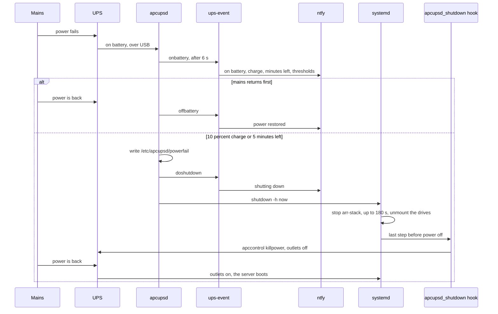

# Power

This page follows a power cut from the moment mains fails to the moment the server is back: how an
APC UPS on USB, apcupsd and the stack's scripts shut the server down cleanly before the battery
runs out, and how it comes back on its own. It is for whoever looks after the server and its
hardware.

Everything here is optional. Without apcupsd installed, `host-install` skips the UPS settings,
`stack-health` skips its POWER section, and a power cut is just a power cut. Installing it is in
[Host setup](../operations/host.md#ups-apcupsd).

## The outage, step by step

1. **Mains fails.** The UPS switches to its battery and tells apcupsd over USB. After 6 seconds on
   battery (`ONBATTERYDELAY 6`, so a flicker stays quiet), apcupsd runs its `onbattery` event and
   [`ups-event`](../reference/scripts.md#ups-event) pushes "media stack: on battery", with the
   charge, the minutes left and the thresholds the server shuts down at. Everything keeps running.
2. **Mains returns before the battery runs low.** apcupsd runs `offbattery`, the push says "media
   stack: power restored", and nothing else happens.
3. **The battery runs low.** At 10% charge (`BATTERYLEVEL 10`) or 5 minutes of runtime left
   (`MINUTES 5`), whichever comes first, apcupsd writes the flag `/etc/apcupsd/powerfail`, runs
   `doshutdown` (the push "media stack: shutting down") and calls `shutdown -h now`.
4. **systemd shuts down cleanly.** [`arr-stack.service`](../reference/systemd.md#arr-stackservice)
   stops the stack with `docker compose stop`, in up to 180 seconds (qBittorrent, Jellyfin and
   Jellystat's Postgres get 30 seconds each), and the drives are unmounted.
5. **The UPS cuts its outlets.** At the very end of the shutdown, Debian's apcupsd hook
   `/usr/lib/systemd/system-shutdown/apcupsd_shutdown` finds the powerfail flag and runs
   `apccontrol killpower`, which tells the UPS to switch its outlets off.
6. **Mains returns.** The UPS switches its outlets back on, and the server boots by itself.
7. **The stack comes back.** The drives mount (their fstab lines have `nofail`, and the udev rules
   mount them when they appear), and `arr-stack.service` starts the stack once the media drive is
   mounted, because the mount unit wants it and it is bound to it. The rest of the boot is in
   [Storage and boot](storage-and-boot.md#at-boot).

### Why the UPS cuts its outlets

A Raspberry Pi 5 with `POWER_OFF_ON_HALT=1`, like most PCs, stays off after a shutdown until its
power is cut and restored. Without `killpower`, an outage that ends after the shutdown but before
the battery is empty would leave the outlets on the whole time, and the server would stay off
until someone pressed its button. Cutting the outlets turns every return of mains into a fresh
power-on.

### What the hardware needs

- **The dock or drive enclosure powers on by itself** when its power returns: a latching power
  switch, not a push button. Otherwise the server boots without its media drive, and the stack
  waits for it.
- **The dock is on a battery-backed outlet** of the UPS, not a surge-only one. A surge-only outlet
  drops the drive the moment mains fails, which is the unclean stop the UPS is there to prevent.
- **The router and modem ideally too**, so the ntfy pushes leave the house during the outage and
  Tailscale stays reachable.

## The settings

[`host/apcupsd/apcupsd.conf`](https://github.com/bugrauluyurt/homelab-media-stack/blob/main/host/apcupsd/apcupsd.conf)
holds them. [`host-install`](../reference/scripts.md#host-install) installs it as
`/etc/apcupsd/apcupsd.conf` when it differs, and they apply after `sudo systemctl restart apcupsd`,
which `host-install` leaves to you. Change them in the repository, not in `/etc`: the next
`host-install` run replaces a copy that differs.

| Setting | Value | Effect |
|---|---|---|
| `UPSCABLE`, `UPSTYPE` | `usb` | The UPS on USB |
| `DEVICE` | empty | apcupsd finds the UPS on USB by itself; a serial path here leaves it in `COMMLOST` |
| `ONBATTERYDELAY` | `6` | Seconds on battery before the `onbattery` event |
| `BATTERYLEVEL` | `10` | Shut down at 10% charge |
| `MINUTES` | `5` | Or at 5 minutes of runtime left, whichever comes first |
| `TIMEOUT` | `0` | No shutdown for time on battery alone |
| `NETSERVER`, `NISIP`, `NISPORT` | `on`, `127.0.0.1`, `3551` | Readings for `apcaccess`, `ups-metrics` and `stack-health`, on this machine only |
| `EVENTSFILE`, `EVENTSFILEMAX` | `/var/log/apcupsd.events`, `1024` | The event log, capped at 1024 KB |

`host-install` also links `/etc/apcupsd/onbattery`, `offbattery`, `doshutdown`, `commfailure`,
`commok` and `changeme` to `scripts/ups-event`. apccontrol runs them as root, and `ups-event`
always exits 0: an event script that exits 99 cancels apccontrol's own action, the shutdown
included.

## Where to see it

| Where | Shows |
|---|---|
| `/usr/sbin/apcaccess status` (sbin is outside a normal user's PATH) | Every reading: `STATUS` (`ONLINE`, `ONBATT`, `COMMLOST`), `BCHARGE`, `TIMELEFT`, `LOADPCT`, `LINEV`, the thresholds `MBATTCHG` and `MINTIMEL` |
| `/var/log/apcupsd.events` | Every power event with its time |
| Grafana, the **UPS** dashboard (`/d/arr-ups`) | Power state, battery, runtime left, load in watts, input voltage and transfers to battery; charge and runtime over time with the shutdown thresholds dashed, load, voltages and an on-battery timeline. [`ups-metrics`](../reference/scripts.md#ups-metrics) writes the readings every 30 seconds |
| Glance, the Lab page's Maintenance block | "UPS on mains power", "On battery power" or "UPS not responding", with the charge and the minutes left; refreshed every 10 minutes |
| `stack-health` | POWER: apcupsd running, the UPS answering it, on mains power, `arr-ups-metrics.timer` enabled |
| `journalctl -b -1` | The previous boot's log, its shutdown included, once the [journal is persistent](../operations/host.md#persistent-journal) |

The pushes, all from `ups-event`:

| apcupsd event | Push |
|---|---|
| `onbattery` | "media stack: on battery", with the charge, the minutes left and the thresholds |
| `offbattery` | "media stack: power restored" |
| `doshutdown` | "media stack: shutting down" |
| `commfailure` | "media stack: UPS not responding": until it is back, a power cut would not shut the server down cleanly |
| `commok` | "media stack: UPS responding again" |
| `changeme` | "media stack: replace the UPS battery" |

## Testing it

### Short test

Unplug the UPS from the wall for 60 seconds, then plug it back in. Expect the "on battery" and
"power restored" pushes, two lines in `/var/log/apcupsd.events`, and everything staying up.

### Full test

This shuts the server down and switches it off: pick a moment when nobody is watching.

1. In `/etc/apcupsd/apcupsd.conf`, set `BATTERYLEVEL 95` (`sudoedit`), then
   `sudo systemctl restart apcupsd`.
2. Unplug the UPS from the wall. Expect "on battery", then "shutting down" once the charge drops
   to 95%, a clean shutdown, and the UPS switching its outlets off.
3. Plug the UPS back in. It switches its outlets on, the server boots by itself, and the stack
   starts with the media drive.
4. Check the shutdown in `journalctl -b -1`, with the persistent journal (`arr-stack.service`
   stopped cleanly, the drives unmounted), then run `health`.
5. Put `BATTERYLEVEL 10` back: `scripts/host-install` reinstalls the repository's file, then
   `sudo systemctl restart apcupsd`.

## Scripts and units involved

| Name | Role | Reference |
|---|---|---|
| `apcupsd.conf` | USB, the thresholds, readings on `127.0.0.1` | [On GitHub](https://github.com/bugrauluyurt/homelab-media-stack/blob/main/host/apcupsd/apcupsd.conf) |
| `host-install` | Installs the settings and the event links | [scripts](../reference/scripts.md#host-install) |
| `ups-event` | One ntfy push per power event | [scripts](../reference/scripts.md#ups-event) |
| `ups-metrics` | The readings for Grafana and Glance | [scripts](../reference/scripts.md#ups-metrics) |
| `arr-ups-metrics.timer` / `.service` | Every 30 seconds, only with apcupsd | [systemd](../reference/systemd.md#arr-ups-metricstimer) |
| `arr-stack.service` | Stops the stack cleanly at shutdown, starts it with the drive at boot | [systemd](../reference/systemd.md#arr-stackservice) |
| `stack-env.sh` | `ups_field`, one apcupsd reading | [scripts](../reference/scripts.md#stack-envsh) |
| `stack-health` | The POWER section | [scripts](../reference/scripts.md#stack-health) |
| `stack-power` skill | UPS status, events and the tests (the tests ask first) | [AI agent](ai-agent.md#the-skills) |

## When it goes wrong

- **`stack-health` fails "UPS answering apcupsd", or a "UPS not responding" push.** apcupsd is in
  `COMMLOST` and a power cut would not shut the server down. Check the USB cable and that `DEVICE`
  is empty in `/etc/apcupsd/apcupsd.conf`, then `sudo systemctl restart apcupsd`.
- **`stack-health` fails "UPS on mains power".** The UPS is on battery right now; the check passes
  once mains is back.
- **The server stayed off after an outage.** The outlets were never cut: look for `killpower` in
  `journalctl -b -1` and for the shutdown in `/var/log/apcupsd.events`.
- **The server is back but the stack is not.** The media drive didn't come back: its dock needs a
  latching switch and a battery-backed outlet. Switch it on; the stack starts with it.
- **No push arrived during the outage.** The router or modem is not on the UPS.
- For anything else, start with [Troubleshooting](../troubleshooting.md).
